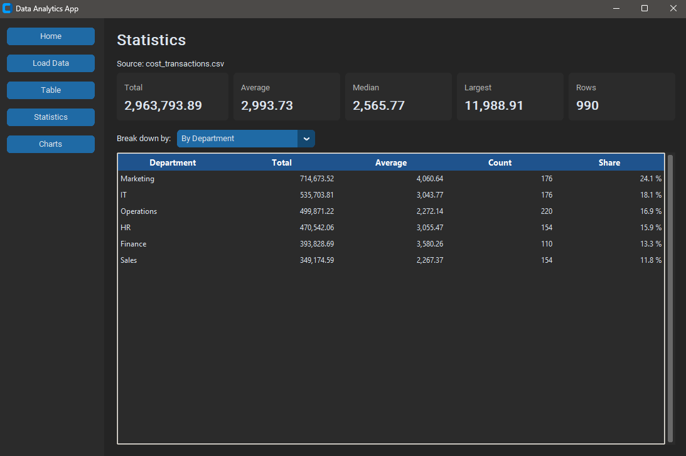
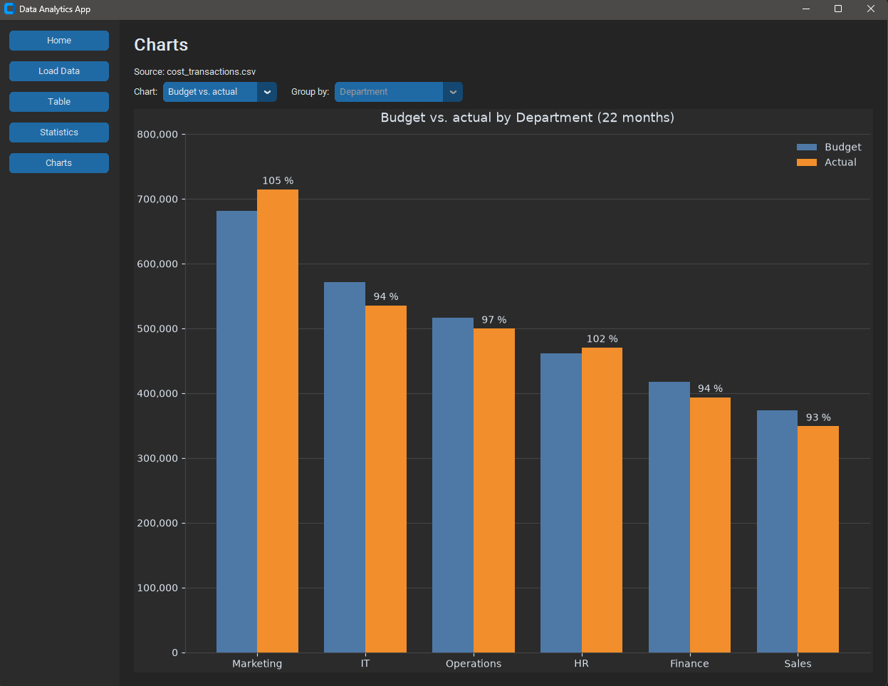
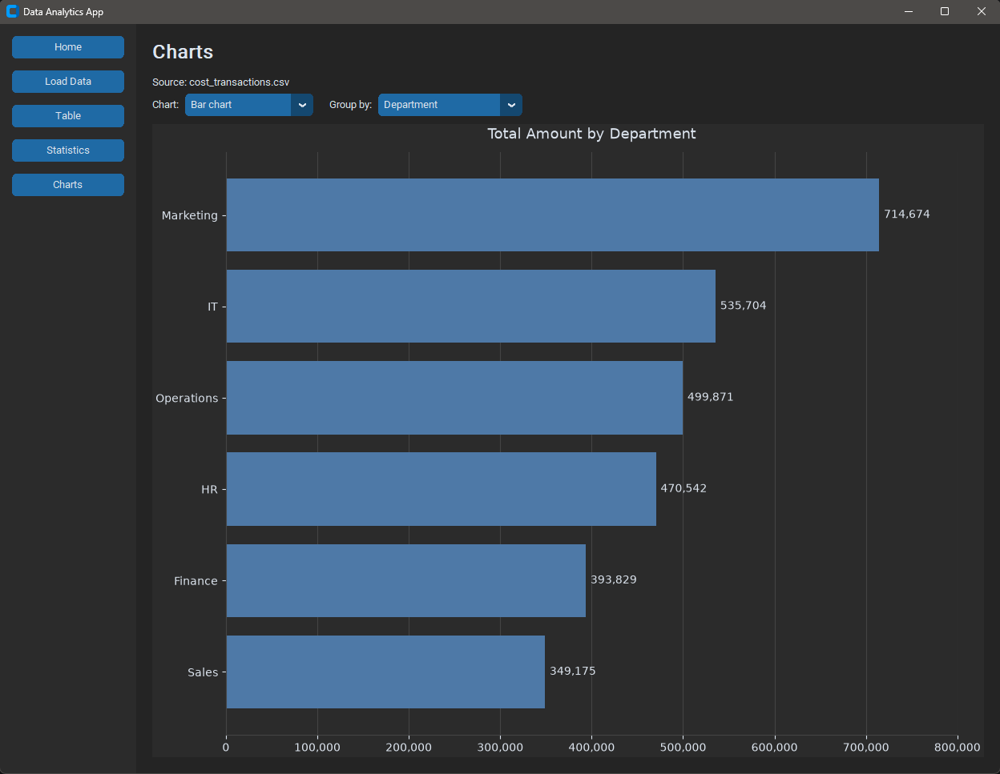

# Cost Analytics App

A desktop app for analyzing costs across departments, categories and time.
Built with Python, Pandas, CustomTkinter and Matplotlib.



## Features

- Load any CSV or Excel file and map its columns to roles (amount, group, category, date),
  so it works with different files, not just the sample data
- Table view with sortable columns
- Statistics: total, average, median and breakdowns by group, category or month
- Charts: bar, line, donut, and budget vs. actual
- Optional budget file with automatic scaling to the length of the data




## Getting started

Requires Python 3.10 or newer.

```
pip install -r requirements.txt
python generate_sample_data.py
python main.py
```

Then open **Load Data**, choose `data/cost_transactions.csv` and press Apply.
To try budget vs. actual, also load `data/department_budgets.csv` as the budget file.

## Project structure

```
├── main.py                  entry point
├── app.py                   main window and navigation
├── generate_sample_data.py  creates reproducible example data
├── core/
│   ├── data_store.py        shared data and column roles
│   ├── analysis.py          pure Pandas analysis functions
│   └── styles.py            shared table styling
└── pages/
    ├── base_page.py         base class for all pages
    ├── home_page.py
    ├── data_page.py
    ├── table_page.py
    ├── stats_page.py
    └── charts_page.py
```

## Design notes

- **One page, one file, one class.** Every page inherits `BasePage`; adding a page means
  adding a file and registering it in `app.py`.
- **Shared `DataStore` with subscribe/notify.** Pages never talk to each other; they
  react when the data changes.
- **Column roles instead of hardcoded names.** Pages ask the store for "the amount column"
  rather than a specific header.
- **Analysis separated from the GUI.** Functions in `core/analysis.py` take DataFrames and
  return DataFrames, so they are easy to test.

## Possible improvements

- Export charts and tables
- Choose the budget period manually
- Unit tests for the analysis functions